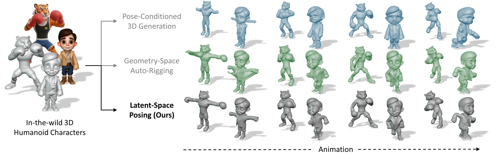

<div align="center">

# Make-It-Poseable: Feed-forward Latent Posing Model for 3D Characters <br> (SIGGRAPH Asia 2026)

_**<a href="https://jasongzy.github.io">Zhiyang Guo</a>,
<a href="https://www.ran-zhang.com/">Ori Zhang</a>,
Jax Xiang,
Alan Zhao,
Zhenxun Yuan,
Wengang Zhou,
Houqiang Li**_

<a href='https://arxiv.org/abs/2512.16767'></a>
<a href='https://jasongzy.github.io/Make-It-Poseable/'></a>



</div>

## Installation

```bash
git clone --recurse-submodules --single-branch https://github.com/jasongzy/Make-It-Poseable
cd Make-It-Poseable
conda create -n mip python=3.11
conda activate mip
pip install -r requirements.txt
```

Make-It-Poseable (MIP) uses a frozen shape VAE from [Hunyuan3D-2.1](https://huggingface.co/tencent/Hunyuan3D-2.1/tree/main/hunyuan3d-vae-v2-1). On first use, the loader downloads the upstream VAE into `~/.cache/hy3dgen`.
For offline use, place `config.yaml` and `model.fp16.ckpt` in `$HY3DGEN_MODELS/tencent/Hunyuan3D-2.1/hunyuan3d-vae-v2-1/` and set `HY3DGEN_MODELS` to your cache root.

## Data Preparation

```bash
hf auth login
hf download jasongzy/Mixamo --repo-type dataset --include 'bones.fbx' --local-dir data/Mixamo
```

For training, also download the character and animation FBXs:

```bash
hf download jasongzy/Mixamo --repo-type dataset \
    --include 'character_refined/**' 'animation/**' 'animation_extra/**' --local-dir data/Mixamo
```

The training also uses HumanRig characters. Please follow [HumanRig dataset and preparation](https://github.com/c8241998/HumanRig) to obtain the necessary data and place the Mixamo-compatible, skinned character FBXs directly in `data/Mixamo/character_humanrig_refined/`.

## Training

```bash
bash train.sh
```

The first stage learns latent posing, while the second stage further trains the adaptive completion module.

## Local Demo

Launch the app with the trained checkpoint:

```bash
python app.py --checkpoint output/mip/completion
```

Open `http://127.0.0.1:7861`, upload a skinned FBX character and click **Preprocess** to download its source pose.
To create a target pose, use Blender to move the source skeleton points in the same coordinate frame and preserve their vertex order and count.
Upload the resulting PLY under **Input Target Pose**, then click **Run** to generate the posed GLB.

For a character that needs a rig first, try [Make-It-Animatable](https://huggingface.co/spaces/jasongzy/Make-It-Animatable-v2).

## Acknowledgements

- [Make-It-Animatable](https://github.com/jasongzy/Make-It-Animatable)
- [Hunyuan3D-2.1](https://github.com/Tencent-Hunyuan/Hunyuan3D-2.1)
- [LVSM](https://github.com/haian-jin/LVSM)

## Citation

```bibtex
@inproceedings{guo2026make,
    author={Guo, Zhiyang and Zhang, Ori and Xiang, Jax and Zhao, Alan and Yuan, Zhenxun and Zhou, Wengang and Li, Houqiang},
    title={{Make-It-Poseable}: Feed-forward Latent Posing Model for {3D} Characters},
    booktitle={SIGGRAPH Asia Conference Papers},
    year={2026},
}
```
